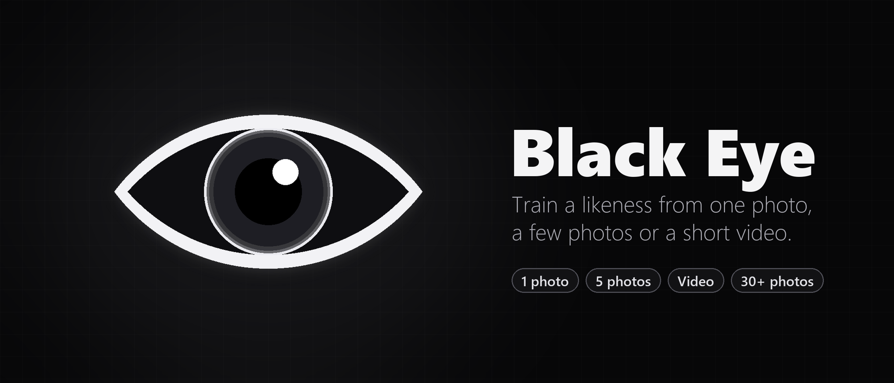
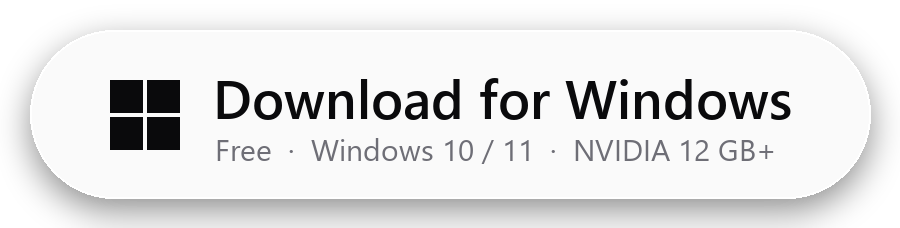
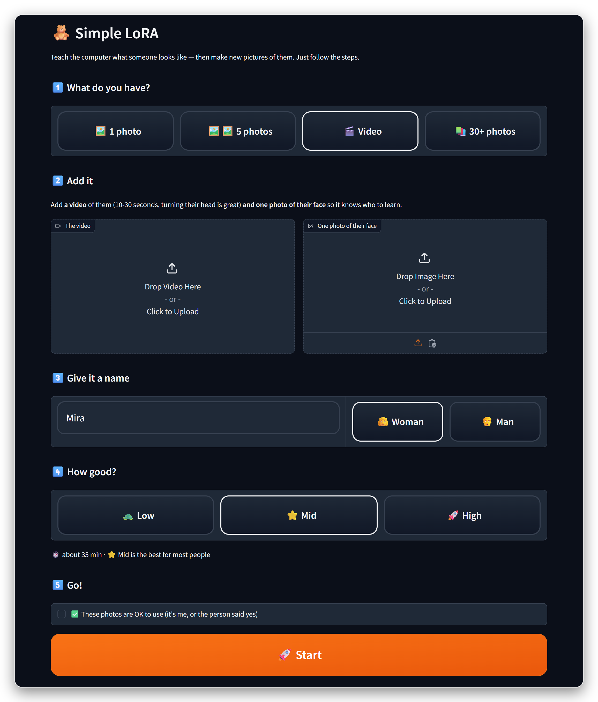
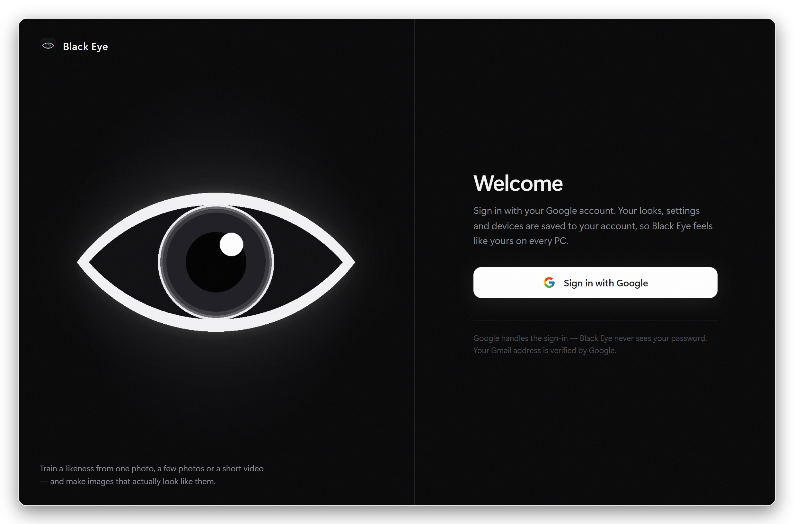
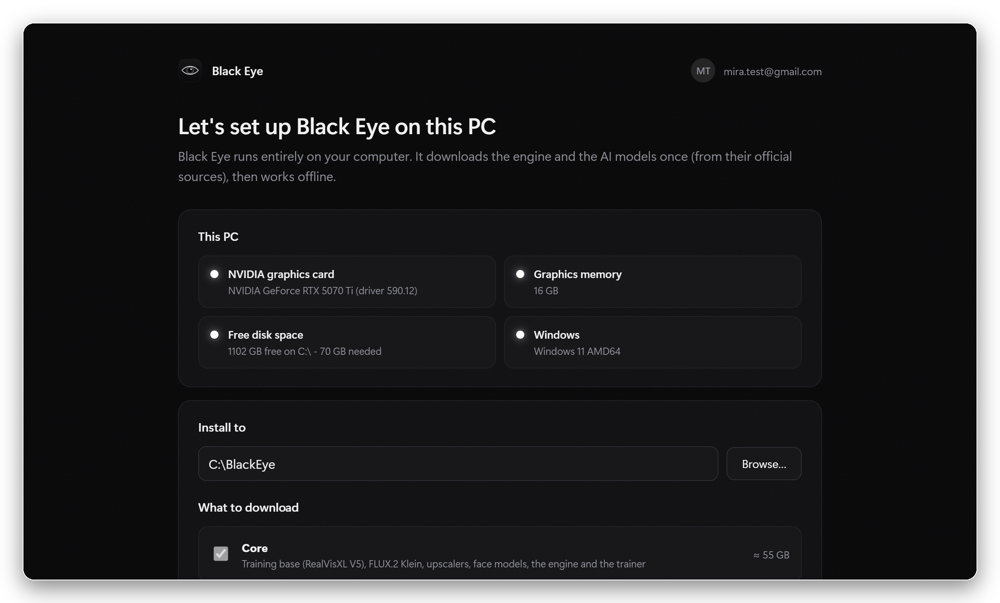
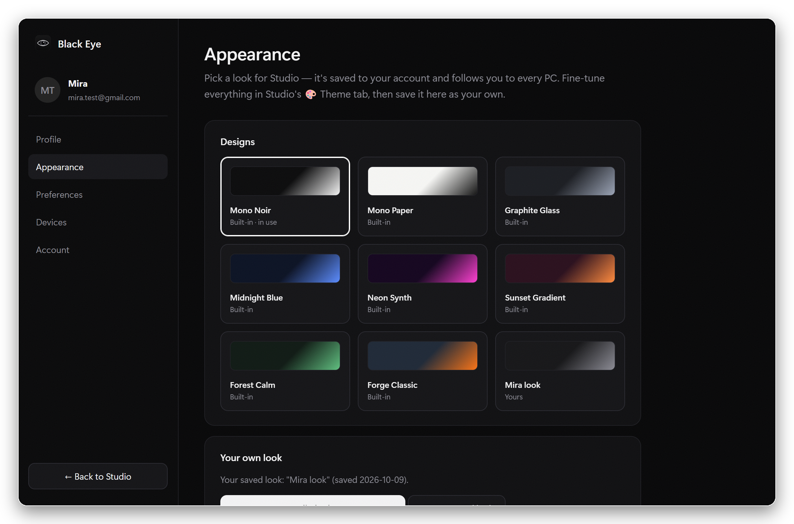
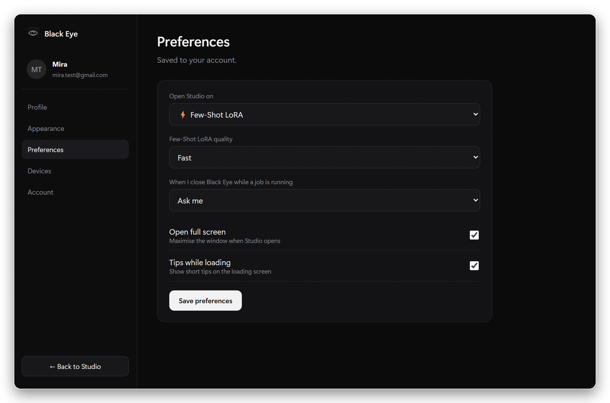
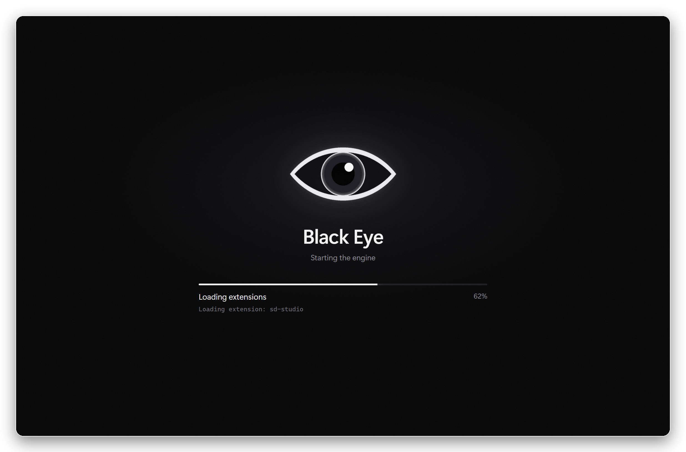

 

  

 

**Black Eye** learns what a person looks like (from **one photo, a few photos or a short video**) and then makes brand-new pictures of
them: new places, new outfits, new angles. Everything runs on your own computer. Your photos never leave it.

 

## ✦ Make a LoRA in five taps

<table>
<tr>
<td width="52%"></td>
<td>

### 🧸 Simple LoRA

1. **What do you have?** 1 photo · 5 photos · a video · 30+ photos
2. **Add it.** Drag it in.
3. **Name it.**
4. **How good?** 🐢 Low · ⭐ Mid · 🚀 High
5. **Start.** Watch it learn, then type what they should be doing.

No settings, no jargon. The trainer, the captions, the face checks and the
best settings for your kind of input are all picked for you.

Want every knob? ⚡ **Few-Shot LoRA** and 🏭 **LoRA Factory** are right
next to it.

</td>
</tr>
</table>

 

## ✦ What's inside

<table>
<tr>
<td width="33%" valign="top">

#### 🎯 Built for likeness
Every training run is checked against the real photos by a face-recognition judge, and the best checkpoint is kept automatically.
**From a single photo, likeness doubled** in our tests.

</td>
<td width="33%" valign="top">

#### 🎬 Video in, LoRA out
Drop in a 10–30 s clip: Black Eye picks the sharpest, most different frames (angles, expressions) and trains on those.

</td>
<td width="33%" valign="top">

#### 🖼️ Best of four
**Make a picture** generates four, scores each one against the real person and shows you the closest match first.

</td>
</tr>
<tr>
<td valign="top">

#### 🔒 Private by design
Training and generation run on your GPU. Your account only stores your look and settings, never photos.

</td>
<td valign="top">

#### 🎨 Your look, everywhere
Sign in with Google: your theme, layout and preferences follow you to every PC.

</td>
<td valign="top">

#### 🔄 Always up to date
New versions download in the background. One click, *Restart to update*, done.

</td>
</tr>
</table>

 

## ✦ A look around

  
  

  
  

 

## ✦ Get started

1. **[Download Black Eye Setup](https://github.com/PumpkinMaster0-0/black-eye/releases/latest/download/BlackEye-Setup.exe)** and run it. No admin rights needed.
2. **Sign in with Google.**
3. **Pick a folder.** Black Eye downloads its engine and AI models once (about 55 GB). Leave it running; if it stops, it picks up where it left off.
4. Open **🧸 Simple LoRA** and make your first one.

> **Windows protected your PC?** Black Eye isn't code-signed yet, so SmartScreen may warn the first time.
> Click **More info → Run anyway**. Updates installed by the app itself don't show this.

 

## ✦ What you need

| | Minimum | Better |
|---|---|---|
| **Graphics card** | NVIDIA, 12 GB | NVIDIA, 16 GB or more |
| **Disk space** | 70 GB free | an SSD |
| **System** | Windows 10 / 11, 64-bit | |
| **Internet** | for the first setup | then it works offline |

 

## ✦ Questions

<b>How long does training take?</b>

 
About 20 minutes on 🐢 Low, 35 on ⭐ Mid (recommended) and 1½ hours on 🚀 High, on a 16 GB card. 30+ photos take a little longer.

<b>Can I use photos of anyone?</b>

 
Only of yourself, or of people who said yes. Black Eye asks you to confirm this every time. Don't use it to make pictures of someone without their consent.

<b>What does my account store?</b>

 
Your name, your chosen look and preferences, and which PCs you're signed in on. Never your photos, LoRAs or pictures.
You can delete your account any time in <b>Account → Delete my account</b>.

<b>How do I uninstall?</b>

 
Windows Settings → <b>Apps → Installed apps → Black Eye → Uninstall</b>. It asks whether to also delete the engine and models to free the space.

 

## ✦ Built on

[Forge Neo](https://github.com/Haoming02/sd-webui-forge-classic) · [AI-Toolkit](https://github.com/ostris/ai-toolkit) ·
[RealVisXL V5](https://huggingface.co/SG161222/RealVisXL_V5.0) · [FLUX.2 Klein](https://huggingface.co/black-forest-labs/FLUX.2-klein-4B) ·
[Z-Image Turbo](https://huggingface.co/Tongyi-MAI/Z-Image-Turbo) · [InsightFace](https://github.com/deepinsight/insightface).
Each keeps its own license; Black Eye downloads them from their official sources.

 

  
Black Eye 1.0.0

